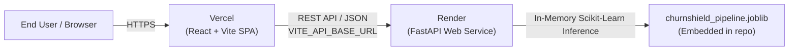

# ChurnShield — Production Deployment Guide

This guide provides exact, step-by-step instructions for deploying the **ChurnShield Full-Stack ML Platform**:
- **Backend API:** FastAPI on [Render](https://render.com)
- **Frontend Webapp:** React + Vite on [Vercel](https://vercel.com)

---

## 1. Architectural Architecture & Pre-Flight Checklist



### Pre-Deployment Audit Results
- **Backend Tests:** 10/10 pytest tests passing (`test_api.py`).
- **Frontend Build:** `npm run build` compiles with 0 TypeScript/lint errors in 1.8s.
- **Model Artifact:** `backend/artifacts/churnshield_pipeline.joblib` is version-controlled and self-contained (6.1 KB).
- **CORS Support:** Configured via `ALLOWED_ORIGINS` environment variable.
- **SPA Routing:** Configured via `webapp/vercel.json` rewrites.

---

## 2. Part A: Deploy Backend API on Render

Deploy the backend first so you have its public URL ready for the frontend.

### Step 1: Create a New Web Service
1. Log in to your [Render Dashboard](https://dashboard.render.com).
2. Click **New +** $\to$ **Web Service**.
3. Select your GitHub repository: `https://github.com/SharmaaAnmol/ChurnShield` (or connect GitHub).

### Step 2: Configure Service Settings

| Setting | Exact Value to Enter | Notes |
| :--- | :--- | :--- |
| **Name** | `churnshield-api` | Will generate URL `https://churnshield-api.onrender.com` |
| **Region** | Choose closest to you (e.g. `Oregon (US West)` or `Frankfurt`) | Lower latency |
| **Branch** | `main` | Production branch |
| **Root Directory** | `backend` | **Important:** Point directly to the `backend` folder |
| **Runtime** | `Python 3` | Python runtime |
| **Build Command** | `pip install -r requirements.txt` | Installs FastAPI, Scikit-Learn, Pandas, etc. |
| **Start Command** | `uvicorn app.main:app --host 0.0.0.0 --port $PORT` | Uses Render's dynamic `$PORT` |
| **Instance Type** | `Free` (or Starter) | Free tier is fully sufficient |

*(Alternative: If Root Directory is left blank, use Build: `pip install -r backend/requirements.txt` and Start: `uvicorn backend.app.main:app --host 0.0.0.0 --port $PORT`)*

### Step 3: Add Environment Variables
Under the **Environment Variables** tab, add:

| Key | Recommended Value | Description |
| :--- | :--- | :--- |
| `HOST` | `0.0.0.0` | Binds to all network interfaces |
| `ALLOWED_ORIGINS` | `*` *(initial)* $\to$ `https://your-app.vercel.app` *(after Vercel deployment)* | CORS protection |
| `PYTHON_VERSION` | `3.11.9` | Optional explicit version |

*(Note: Do not define `PORT` manually; Render injects it automatically into the runtime).*

### Step 4: Health Check Path
- Under **Advanced Settings**, set **Health Check Path** to `/api/health`.

### Step 5: Deploy & Verify
1. Click **Create Web Service**.
2. Once the build finishes, test the endpoints in your browser:
   - Root discovery: `https://churnshield-api.onrender.com/`
   - Health check: `https://churnshield-api.onrender.com/api/health`
   - Swagger Docs: `https://churnshield-api.onrender.com/docs`
   - Model metadata: `https://churnshield-api.onrender.com/api/model-info`

---

## 3. Part B: Deploy Frontend on Vercel

### Step 1: Import Project in Vercel
1. Log in to [Vercel](https://vercel.com).
2. Click **Add New...** $\to$ **Project**.
3. Import your GitHub repository: `ChurnShield`.

### Step 2: Configure Project Settings

| Setting | Exact Value to Enter | Notes |
| :--- | :--- | :--- |
| **Project Name** | `churnshield` | Or your preferred domain name |
| **Framework Preset** | `Vite` | Auto-detects Vite configuration |
| **Root Directory** | `webapp` | **Click "Edit" and choose `webapp`** |
| **Build Command** | `npm run build` | Runs `tsc && vite build` |
| **Output Directory** | `dist` | Default Vite build output |
| **Install Command** | `npm install` | Uses `package.json` |

### Step 3: Configure Environment Variables
Under the **Environment Variables** section, add:

| Name | Value |
| :--- | :--- |
| `VITE_API_BASE_URL` | `https://churnshield-api.onrender.com` *(Replace with your actual Render URL from Part A)* |

*(Important: Do NOT include a trailing slash in the URL).*

### Step 4: Deploy & Verify
1. Click **Deploy**.
2. Vercel will run the build and publish the application.
3. Test the following:
   - Load homepage: `https://churnshield.vercel.app`
   - Navigate to **Prediction Studio**: `https://churnshield.vercel.app/prediction-studio`
   - Hit browser refresh (**F5**) on `/prediction-studio` (verified by `vercel.json` SPA rewrite rule).
   - Click **Run Model Prediction** and verify the backend responds with a live calculation.

---

## 4. Part C: Post-Deployment Security Lockdown (Optional but Recommended)

Once Vercel has assigned your frontend domain (e.g., `https://churnshield.vercel.app`):
1. Go back to your [Render Dashboard](https://dashboard.render.com) $\to$ `churnshield-api` $\to$ **Environment Variables**.
2. Update `ALLOWED_ORIGINS` from `*` to your exact frontend domain:
   ```text
   ALLOWED_ORIGINS=https://churnshield.vercel.app,http://localhost:5173
   ```
3. Render will automatically redeploy the backend with strict CORS protection.

---

## 5. Troubleshooting & FAQ

### Q: Does the Render service spin down on the free tier?
**Yes.** Render free instances spin down after 15 minutes of inactivity. The first request after a sleep period may take ~30–50 seconds to warm up. Once active, response times return to $<100\text{ ms}$. If the backend is warming up, ChurnShield's frontend displays a retry notification.

### Q: Are any secrets embedded in the frontend bundle?
**No.** The frontend only accesses the public API base URL `VITE_API_BASE_URL`. There are no database credentials, private API keys, or proprietary secrets in the repository or browser bundle.

### Q: Is the model artifact safe in Git?
**Yes.** `churnshield_pipeline.joblib` is only 6.1 KB and `model_weights.json` is 4.1 KB. Both are checked into Git, ensuring Render has immediate access to the model at build time without needing S3 or remote storage credentials.
