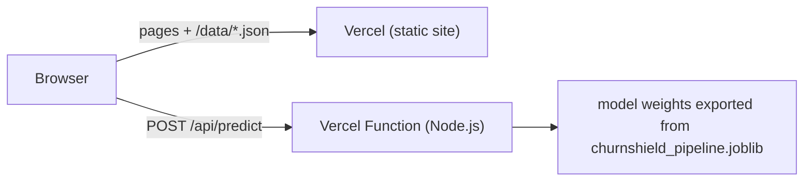

# ChurnShield — Deployment Guide

The whole site, including the prediction API, runs on **Vercel** from the `webapp/` folder of this repository.
There is no separate backend server.



## How a deploy happens

1. Push to `main` on GitHub.
2. Vercel builds `webapp/` (`npm run build`) and deploys the static site plus the functions in `webapp/api/`.
3. Pushes to any other branch get a preview deployment (behind Vercel login).

Vercel project settings:

| Setting | Value |
|---|---|
| Root Directory | `webapp` |
| Framework preset | Vite (Node.js 24) |
| Build command | `npm run build` |
| Output directory | Vite default (`dist`) |
| Environment variables | none needed |

`webapp/vercel.json` sends every non-`/api/` path to `index.html` so page links work on reload.

## Before you push

From the repository root:

```bash
python export_webapp_data.py --check
```

From `webapp/`:

```bash
npm run check:api
```

```bash
npm run build
```

The first proves every served data file matches the repo artifacts, the second that `/api/predict` matches scikit-learn.

## After a deploy

```bash
curl https://churn-shield-omega.vercel.app/api/health
```

It should return `"status":"healthy"`. Then open **Try the model**: under the score it should say *scored by /api/predict*.
If it says *scored in your browser*, the function failed; check the function logs in the Vercel dashboard.

## Local development

```bash
cd webapp && npm install && npm run dev
```

`vite dev` doesn't run Vercel Functions, so locally the Try-the-model page scores in the browser with the same weights.
To run the functions too, use `vercel dev`.

## Reference Python API

`backend/` holds the original FastAPI service and its pytest suite. It is not deployed.
Run it with `uvicorn main:app` from the repository root after `pip install -r requirements.txt`.
