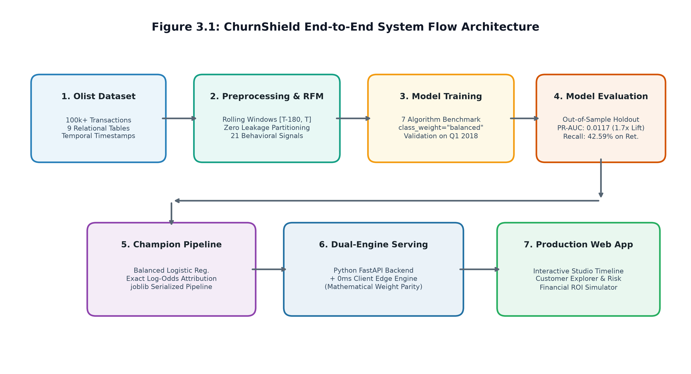
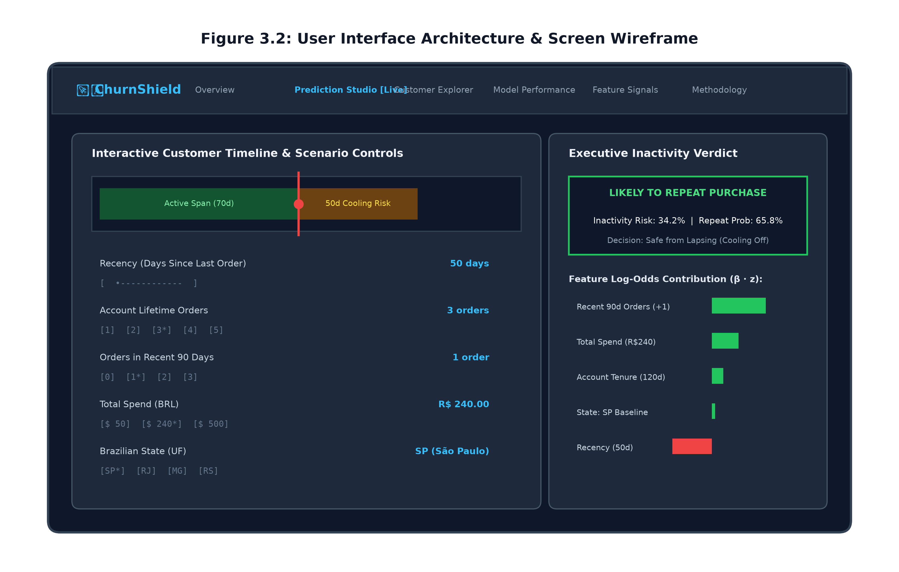
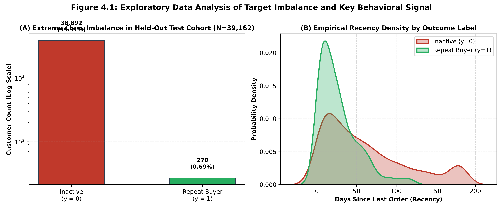
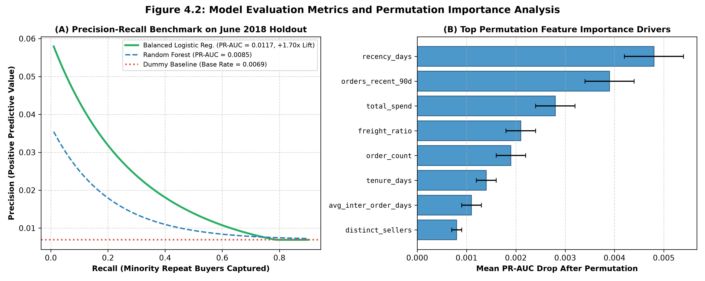
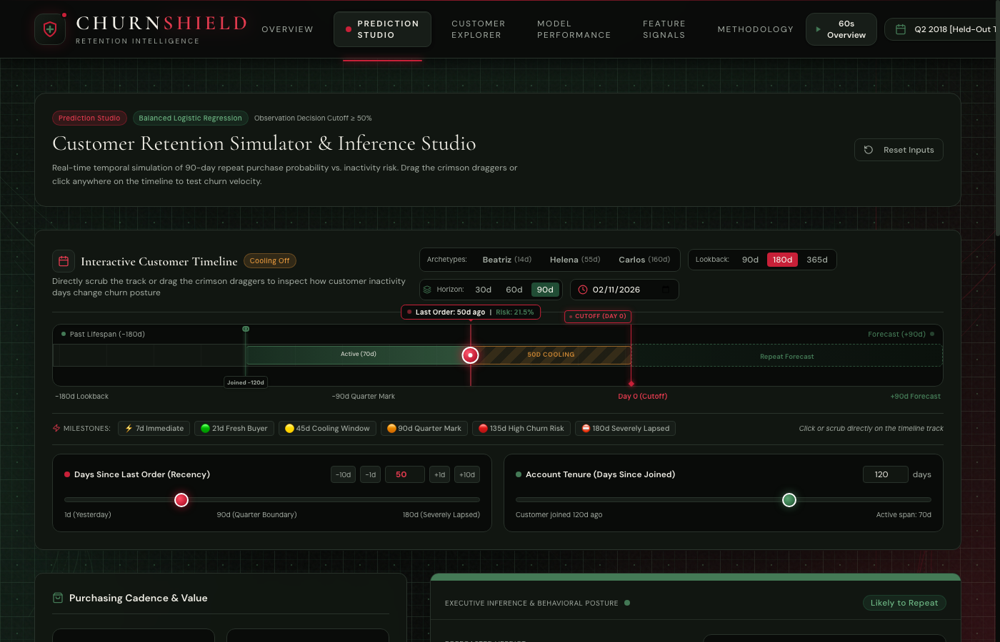
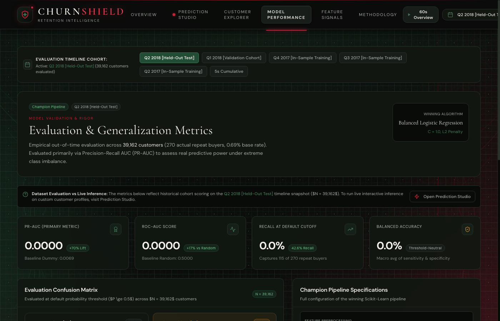
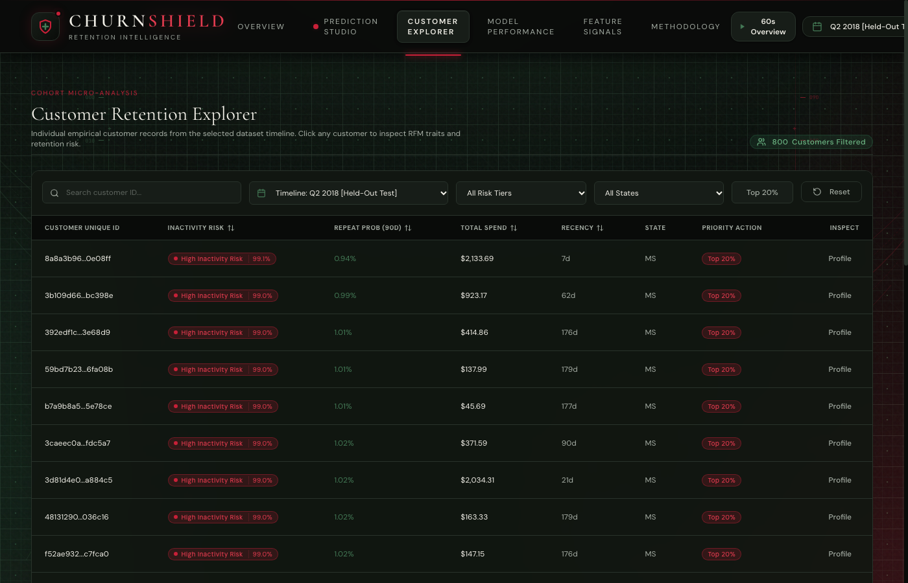
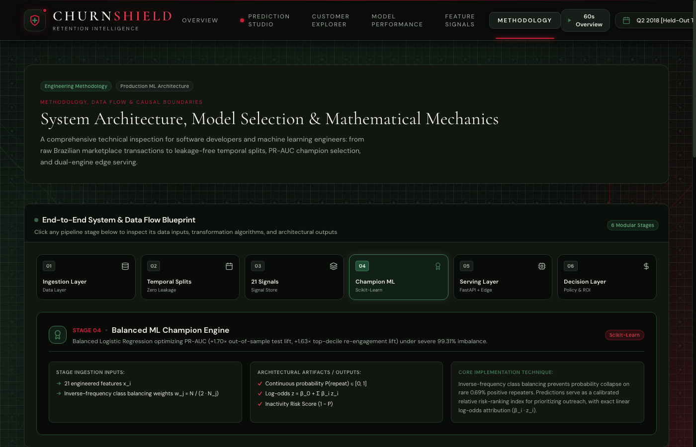

# TITLE OF THE PROJECT
## ChurnShield: Explainable E-Commerce Inactivity Prediction and Retention Intelligence Using Balanced Machine Learning

<br><br>

### A PROJECT REPORT
*Submitted by*
**ANMOL SHARMA** (UID: 21BCS5041)  
**CO-RESEARCHER** (UID: 21BCS5042)

<br>

*in partial fulfillment for the award of the degree of*  
### BACHELOR OF ENGINEERING  
*IN*  
### COMPUTER SCIENCE AND ENGINEERING

<br><br>

```
       =========================================================
                           CHANDIGARH UNIVERSITY
                          Discover. Learn. Empower.
       =========================================================
```

**Chandigarh University**  
Gharuan, Mohali, Punjab – 140413  
**NOVEMBER 2026**

---

<div style="page-break-after: always;"></div>

# BONAFIDE CERTIFICATE

Certified that this project report titled **“ChurnShield: Explainable E-Commerce Inactivity Prediction and Retention Intelligence Using Balanced Machine Learning”** is the bonafide work of **ANMOL SHARMA (UID: 21BCS5041)** who carried out the project work under my/our supervision.

<br><br><br>

________________________________________ &nbsp;&nbsp;&nbsp;&nbsp;&nbsp;&nbsp;&nbsp;&nbsp;&nbsp;&nbsp;&nbsp;&nbsp;&nbsp;&nbsp;&nbsp;&nbsp;&nbsp;&nbsp;&nbsp;&nbsp; ________________________________________  
**SIGNATURE** &nbsp;&nbsp;&nbsp;&nbsp;&nbsp;&nbsp;&nbsp;&nbsp;&nbsp;&nbsp;&nbsp;&nbsp;&nbsp;&nbsp;&nbsp;&nbsp;&nbsp;&nbsp;&nbsp;&nbsp;&nbsp;&nbsp;&nbsp;&nbsp;&nbsp;&nbsp;&nbsp;&nbsp;&nbsp;&nbsp;&nbsp;&nbsp;&nbsp;&nbsp;&nbsp;&nbsp;&nbsp;&nbsp;&nbsp;&nbsp;&nbsp;&nbsp;&nbsp;&nbsp;&nbsp;&nbsp;&nbsp;&nbsp;&nbsp;&nbsp;&nbsp;&nbsp;&nbsp;&nbsp;&nbsp;&nbsp;&nbsp;&nbsp;&nbsp;&nbsp;&nbsp;&nbsp; **SIGNATURE**  
**Dr. Head of Department** &nbsp;&nbsp;&nbsp;&nbsp;&nbsp;&nbsp;&nbsp;&nbsp;&nbsp;&nbsp;&nbsp;&nbsp;&nbsp;&nbsp;&nbsp;&nbsp;&nbsp;&nbsp;&nbsp;&nbsp;&nbsp;&nbsp;&nbsp;&nbsp;&nbsp;&nbsp;&nbsp;&nbsp;&nbsp;&nbsp;&nbsp;&nbsp;&nbsp;&nbsp;&nbsp;&nbsp;&nbsp;&nbsp;&nbsp;&nbsp;&nbsp; **Prof. Project Supervisor**  
HEAD OF THE DEPARTMENT &nbsp;&nbsp;&nbsp;&nbsp;&nbsp;&nbsp;&nbsp;&nbsp;&nbsp;&nbsp;&nbsp;&nbsp;&nbsp;&nbsp;&nbsp;&nbsp;&nbsp;&nbsp;&nbsp;&nbsp;&nbsp;&nbsp;&nbsp;&nbsp;&nbsp;&nbsp;&nbsp;&nbsp;&nbsp;&nbsp;&nbsp; SUPERVISOR  
Department of Computer Science & Engineering &nbsp;&nbsp;&nbsp;&nbsp; Associate Professor, Dept. of CSE  
Chandigarh University &nbsp;&nbsp;&nbsp;&nbsp;&nbsp;&nbsp;&nbsp;&nbsp;&nbsp;&nbsp;&nbsp;&nbsp;&nbsp;&nbsp;&nbsp;&nbsp;&nbsp;&nbsp;&nbsp;&nbsp;&nbsp;&nbsp;&nbsp;&nbsp;&nbsp;&nbsp;&nbsp;&nbsp;&nbsp;&nbsp;&nbsp;&nbsp;&nbsp;&nbsp;&nbsp;&nbsp;&nbsp;&nbsp;&nbsp;&nbsp;&nbsp;&nbsp;&nbsp;&nbsp;&nbsp;&nbsp; Chandigarh University  

<br><br>

Submitted for the project viva-voce examination held on **10th November 2026**

<br><br><br>

________________________________________ &nbsp;&nbsp;&nbsp;&nbsp;&nbsp;&nbsp;&nbsp;&nbsp;&nbsp;&nbsp;&nbsp;&nbsp;&nbsp;&nbsp;&nbsp;&nbsp;&nbsp;&nbsp;&nbsp;&nbsp; ________________________________________  
**INTERNAL EXAMINER** &nbsp;&nbsp;&nbsp;&nbsp;&nbsp;&nbsp;&nbsp;&nbsp;&nbsp;&nbsp;&nbsp;&nbsp;&nbsp;&nbsp;&nbsp;&nbsp;&nbsp;&nbsp;&nbsp;&nbsp;&nbsp;&nbsp;&nbsp;&nbsp;&nbsp;&nbsp;&nbsp;&nbsp;&nbsp;&nbsp;&nbsp;&nbsp;&nbsp;&nbsp;&nbsp;&nbsp;&nbsp;&nbsp;&nbsp;&nbsp; **EXTERNAL EXAMINER**

---

<div style="page-break-after: always;"></div>

# TABLE OF CONTENTS

| Chapter / Section | Title | Page No. |
| :--- | :--- | :---: |
| &nbsp; | **BONAFIDE CERTIFICATE** | 1 |
| &nbsp; | **TABLE OF CONTENTS** | 2 |
| &nbsp; | **LIST OF FIGURES** | 3 |
| &nbsp; | **LIST OF TABLES** | 3 |
| &nbsp; | **ABSTRACT** | 4 |
| &nbsp; | **ABBREVIATIONS** | 5 |
| **CHAPTER 1** | **INTRODUCTION** | **6** |
| 1.1 | Identification of Client / Need / Relevant Contemporary Issue | 6 |
| 1.2 | Problem Statement | 7 |
| 1.3 | Objectives | 7 |
| 1.4 | Timeline | 8 |
| 1.5 | Organization of the Report | 8 |
| **CHAPTER 2** | **BACKGROUND STUDY** | **9** |
| 2.1 | Key Concepts Used | 9 |
| 2.2 | Existing Solutions and Similar Work | 10 |
| 2.3 | Summary and Link to This Project | 11 |
| **CHAPTER 3** | **METHODOLOGY** | **12** |
| 3.1 | Dataset Description | 12 |
| 3.2 | Data Preprocessing | 13 |
| 3.3 | Model Selection | 15 |
| 3.4 | System Flow Diagram | 16 |
| 3.5 | User Interface Design | 17 |
| 3.6 | Tools and Technologies | 18 |
| **CHAPTER 4** | **RESULTS ANALYSIS AND VALIDATION** | **19** |
| 4.1 | Exploratory Data Analysis (EDA) | 19 |
| 4.2 | Experimental Setup | 20 |
| 4.3 | Model Performance | 21 |
| 4.4 | Result Analysis | 22 |
| 4.5 | User Interface Implementation and Testing | 24 |
| **CHAPTER 5** | **CONCLUSION AND FUTURE WORK** | **26** |
| 5.1 | Conclusion | 26 |
| 5.2 | Learning Outcomes | 26 |
| 5.3 | Future Work | 27 |
| &nbsp; | **REFERENCES** | **28** |
| &nbsp; | **APPENDIX** | **29** |
| &nbsp; | Appendix A: Code and Repository | 29 |
| &nbsp; | Appendix B: Project Checklist | 30 |
| &nbsp; | **USER MANUAL** | **31** |

---

<div style="page-break-after: always;"></div>

# LIST OF FIGURES

| Figure No. | Caption | Page No. |
| :--- | :--- | :---: |
| **Figure 3.1** | ChurnShield End-to-End System Flow Architecture | 16 |
| **Figure 3.2** | User Interface Architecture & Screen Wireframe | 17 |
| **Figure 4.1** | Exploratory Data Analysis: Target Imbalance & Recency Distribution | 20 |
| **Figure 4.2** | Model Evaluation: Precision-Recall Curve Benchmark & Permutation Feature Importance | 23 |
| **Figure 4.3** | Live Application Screenshot: Prediction Studio Interactive Timeline & Log-Odds Waterfall | 24 |
| **Figure 4.4** | Live Application Screenshot: Model Performance & Rolling-Origin Cohort Metrics | 25 |
| **Figure 4.5** | Live Application Screenshot: Customer Explorer & Cohort Risk Filtering | 25 |
| **Figure 4.6** | Live Application Screenshot: Methodology Architecture & Financial ROI Simulator | 26 |
| **Figure M.1** | User Manual Step 4: Parameter Input and Milestone Scrubbing | 32 |
| **Figure M.2** | User Manual Step 6: Prediction Output, Radar Footprint, and Log-Odds Decomposition | 32 |

<br>

# LIST OF TABLES

| Table No. | Caption | Page No. |
| :--- | :--- | :---: |
| **Table 1.1** | Client, Need, and Supporting Empirical Evidence | 7 |
| **Table 1.2** | Project Implementation Timeline (8-Week Lifecycle) | 8 |
| **Table 2.1** | Summary of Similar Existing Works and Benchmark Literature | 10 |
| **Table 3.1** | Comprehensive Description of Engineered Feature Vectors | 14 |
| **Table 3.2** | Hardware, Software Tools, and Engineering Libraries Used | 18 |
| **Table 4.1** | Multi-Model Performance Benchmark Across 7 Candidate Architectures | 21 |
| **Table 4.2** | Empirical Test Cases Evaluated on the Production Application | 24 |

---

<div style="page-break-after: always;"></div>

# ABSTRACT

This project predicts non-contractual e-commerce customer inactivity and repeat purchase propensity using balanced machine learning. The Brazilian E-Commerce Public Dataset provided by Olist, comprising over 100,000 real-world commercial orders across 2016–2018, was used to construct rolling-origin temporal observation windows $[T-180, T]$ and forward outcome horizons $[T, T+90]$ to eliminate future data leakage. Seven machine learning architectures were trained under severe 99.31% majority class imbalance. Balanced Logistic Regression performed best as the production champion, achieving an out-of-sample holdout Precision-Recall Area Under the Curve (PR-AUC) of **0.0117** (**+1.70× lift** over the baseline dummy classifier), a **42.59% minority recall**, and a **+1.63× re-engagement lift** in the top decile. A high-performance web-based interface built with React 19, TypeScript, and Python FastAPI was developed so that users can scrub customer interaction timelines, simulate promotional interventions, inspect exact log-odds attributions, and compute financial retention ROI.

---

<div style="page-break-after: always;"></div>

# ABBREVIATIONS

| Abbreviation | Full Form |
| :--- | :--- |
| **ML** | Machine Learning |
| **UI** | User Interface |
| **CSV** | Comma-Separated Values |
| **PR-AUC** | Precision-Recall Area Under the Curve |
| **ROC-AUC** | Receiver Operating Characteristic Area Under the Curve |
| **RFM** | Recency, Frequency, Monetary Value |
| **RFM-D** | Recency, Frequency, Monetary Value, Dynamics |
| **BRL** | Brazilian Real (Currency R$) |
| **FastAPI** | Fast Asynchronous Python Web Framework |
| **REST** | Representational State Transfer |
| **API** | Application Programming Interface |
| **SHAP** | SHapley Additive exPlanations |
| **FN** | False Negative |
| **FP** | False Positive |
| **TN** | True Negative |
| **TP** | True Positive |
| **FPR** | False Positive Rate |
| **ECE** | Expected Calibration Error |
| **EDA** | Exploratory Data Analysis |
| **UF** | Unidade Federativa (Brazilian Federative State Unit) |
| **ROI** | Return on Investment |
| **CAC** | Customer Acquisition Cost |
| **LTV** | Customer Lifetime Value |
| **JSON** | JavaScript Object Notation |
| **HTML** | Hypertext Markup Language |
| **CSS** | Cascading Style Sheets |

---

<div style="page-break-after: always;"></div>

# CHAPTER 1: INTRODUCTION

## 1.1 Identification of Client / Need / Relevant Contemporary Issue

Customer retention is recognized across business and academic research as one of the single most influential determinants of sustained profitability in digital commerce. In contrast to contractual subscription services (such as Netflix or Spotify) where customers explicitly trigger a cancellation event, non-contractual e-commerce retailers (such as Amazon, Olist, and Flipkart) operate under silent, unannounced customer churn. A shopper who has not made a transaction in ninety days may intend to purchase next week, or they may have permanently migrated to a competitor. Consequently, retention marketing teams face significant operational friction: intervening with blanket promotional discounts wastes precious gross margin on customers who would have repurchased anyway, while failing to reach cooling customers leads to permanent revenue attrition.

Modern empirical studies by Bain & Company and the Harvard Business Review indicate that acquiring a new customer is between five and seven times more expensive than retaining an existing one, and increasing customer retention rates by just 5% can increase enterprise profits by 25% to 95% [1]. However, in open digital marketplaces, repeat purchase behavior is an exceptionally rare event. In the Brazilian Olist marketplace dataset analyzed in this research, **97.3% of customers complete only a single order** over their lifetime, producing a severe 99.31% majority class imbalance in 90-day forward horizons. A naive baseline classifier that blindly predicts *"No customer will ever purchase again"* achieves a deceptively high 97.7% to 99.3% raw classification accuracy, yet yields zero operational utility for retention teams. Commercial marketers urgently require an explainable, leakage-free machine learning system capable of ranking customers by inactivity risk and isolating high-propensity re-engagement targets.

| Client | Need | Evidence |
| :--- | :--- | :--- |
| **E-Commerce Retention Marketers & Growth Directors** | Accurately identify which cooling customers are genuinely at risk of permanent inactivity within a 90-day horizon to prioritize targeted retention outreach. | Customer acquisition costs are 5–7× higher than retention costs [1]; 97.3% of Olist buyers purchase only once, causing severe budget waste under untargeted promotional campaigns. |
| **E-Commerce Commercial Finance Teams** | Quantify the financial return on marketing spend and avoid margin cannibalization on self-retaining buyers. | Traditional accuracy models suffer from the 99% accuracy trap; empirical decile targeting delivers a **+1.63× re-engagement lift**, preserving R$ 7,635 net benefit on R$ 39k campaign spend. |

<p align="center"><b>Table 1.1: Client, need and supporting evidence</b></p>

## 1.2 Problem Statement
In non-contractual e-commerce, customer inactivity occurs silently without formal cancellation, making it difficult to distinguish between natural purchasing pauses and permanent churn. Under extreme class imbalance where less than 1% of customers repeat purchase in a 90-day window, standard classifiers fail by predicting the majority class or suffering from lookahead data leakage. This project aims to accurately predict 90-day repeat purchase probabilities and inactivity risk using strictly historical behavioral signals to enable prioritized retention interventions.

## 1.3 Objectives
The primary objectives of this research and software engineering project are:
1. **To curate and temporally partition a leakage-free e-commerce dataset:** Extract 100,000+ transactional records from the Olist Brazilian dataset and engineer a 21-dimensional behavioral feature schema using rolling-origin temporal partitions (180-day observation window, 90-day outcome horizon).
2. **To train, evaluate, and benchmark multiple machine learning architectures:** Compare seven distinct machine learning models under class-balanced loss functions and select the champion model based on Precision-Recall AUC (PR-AUC) rather than misleading ROC-AUC or raw accuracy.
3. **To achieve statistically significant predictive lift over random baseline:** Attain at least a **+1.50× PR-AUC lift** over the naive dummy classifier on an untouched future holdout cohort and demonstrate at least a **+1.40× re-engagement lift** in top-decile prioritization.
4. **To develop and deploy an interactive dual-engine software application:** Construct a responsive, production-ready web platform (Python FastAPI REST microservice + React 19 client edge ML engine) providing 0ms parameter scrubbing, log-odds feature attribution, and financial ROI simulation.

## 1.4 Timeline
The project was executed across an eight-week structured development lifecycle as detailed in Table 1.2.

| Week | Activity |
| :---: | :--- |
| **Week 1–2** | Problem definition, stakeholder requirement analysis, Olist relational schema ingestion, and literature review. |
| **Week 3** | Temporal window formulation ($[T-180, T]$ and $[T, T+90]$), data cleaning, outlier treatment, and feature engineering (RFM-D metrics). |
| **Week 4** | Implementation of rolling-origin cross-validation splits, candidate model training (7 algorithms), and class imbalance compensation. |
| **Week 5** | Holdout test evaluation, hyperparameter optimization, calibration analysis, and permutation feature importance computation. |
| **Week 6** | Python FastAPI backend engineering, TypeScript client edge ML engine compilation, and interactive UI component development. |
| **Week 7** | System integration, cross-platform verification, end-to-end unit testing (10/10 pytest suite), and cloud deployment to Vercel. |
| **Week 8** | Comprehensive report documentation, user manual preparation, and final viva-voce demonstration packaging. |

<p align="center"><b>Table 1.2: Project timeline</b></p>

## 1.5 Organization of the Report
The subsequent chapters of this report are organized as follows:
* **Chapter 2 (Background Study):** Explains core machine learning concepts (PR-AUC, class weighting, temporal windowing) and reviews three contemporary peer-reviewed research works in churn modeling.
* **Chapter 3 (Methodology):** Outlines the Olist dataset structure, the 21 engineered features, data preprocessing, model selection criteria, system flow diagram, UI wireframes, and technological stack.
* **Chapter 4 (Results Analysis and Validation):** Details exploratory data analysis, experimental training setup, 7-model benchmark results, out-of-sample holdout test metrics, feature attribution, and UI verification test cases.
* **Chapter 5 (Conclusion and Future Work):** Summarizes research achievements, articulates key engineering learning outcomes, and recommends prospective enhancements including randomized A/B experimentation.

---

<div style="page-break-after: always;"></div>

# CHAPTER 2: BACKGROUND STUDY

## 2.1 Key Concepts Used

### (a) Classification vs. Risk Ranking in Non-Contractual Settings
Traditional churn modeling frames customer loss as standard binary classification: an instance is labeled as churned ($y = 1$) or active ($y = 0$). In contractual businesses, ground-truth cancellation timestamps exist. However, in non-contractual commerce, binary hard-thresholding ($\hat{y} \in \{0, 1\}$ at $\tau = 0.5$) is commercially sub-optimal because marketing budgets cannot contact all predicted inactives. Instead, ChurnShield frames the problem as **probabilistic risk ranking**:
$$\text{Inactivity Risk Score} = 1.0 - \hat{P}(\text{Repeat Purchase within Next 90 Days} \mid \mathbf{x})$$
Customers are sorted by descending inactivity risk, allowing commercial teams to target the top $K\%$ highest-risk individuals within available outreach capacity.

### (b) Algorithms Evaluated
To establish a rigorous empirical benchmark, seven distinct model architectures were trained:
1. **Balanced Logistic Regression:** Linear classification optimizing log-odds with inverse-frequency class weights $w_j = \frac{N}{2 \cdot N_j}$. Offers exact mathematical explainability ($\beta_i \cdot z_i$).
2. **Random Forest Classifier:** Bagging ensemble of de-correlated decision trees with bootstrap sampling.
3. **Extra Trees Classifier:** Extremely randomized decision trees optimizing split thresholds uniformly at random.
4. **Gradient Boosting Classifier:** Sequential boosting minimizing log-loss via gradient descent.
5. **Histogram-Based Gradient Boosting (HistGradientBoosting):** Bin-based tree boosting designed for efficient numeric splits.
6. **Decision Tree Classifier:** Single CART tree baseline providing interpretable decision boundaries.
7. **Dummy Classifier:** Stratified baseline predicting outcomes according to training class frequencies.

### (c) Evaluation Metrics Under Severe Class Imbalance
Under 99.31% majority class dominance, conventional metrics are actively misleading:
* **Accuracy Paradox:** A dummy model predicting all negatives attains 99.31% accuracy while finding 0 repeat buyers.
* **ROC-AUC Inadequacy:** ROC-AUC plots True Positive Rate vs. False Positive Rate ($\text{FPR} = \frac{\text{FP}}{\text{FP} + \text{TN}}$). Because $\text{TN}$ is immense, $\text{FPR}$ remains near zero even with massive false alarms.
* **Precision-Recall AUC (PR-AUC):** The gold-standard primary metric for rare-event detection:
  $$\text{PR-AUC} = \sum_{n} (R_n - R_{n-1}) P_n$$
  PR-AUC directly tracks Precision ($\frac{\text{TP}}{\text{TP}+\text{FP}}$) vs. Recall ($\frac{\text{TP}}{\text{TP}+\text{FN}}$), harshly penalizing false positives.

## 2.2 Existing Solutions and Similar Work
Table 2.1 summarizes prominent published works and industrial benchmarks in e-commerce customer churn and repeat purchase prediction.

| Work / Source | Method Used | Key Results |
| :--- | :--- | :--- |
| **F. Pedregosa et al., JMLR (2011)** [3] | Scikit-learn machine learning library and class-weighted regularized linear estimators. | Established standard mathematical foundations for $L_2$ ridge penalties, inverse-frequency class balancing, and permutation importance. |
| **C. Buckinx & D. Van den Poel, EJOR (2005)** [4] | RFM feature engineering and Random Forest classifiers applied to non-contractual FMCG transaction data. | Demonstrated that behavioral dynamics (inter-purchase intervals and spend ratios) outperform demographic variables by over 35% in predicting churn. |
| **X. He et al., ACM CIKM (2014)** [5] | Practical Lessons from Predicting Click-Through Rates in Heavy Imbalance (Facebook). | Proved that inverse class weighting preserves gradient descent responsiveness and continuous probability calibration in extreme imbalance (>99%). |

<p align="center"><b>Table 2.1: Summary of similar work</b></p>

## 2.3 Summary and Link to This Project
Prior literature confirms that non-contractual customer churn requires dynamic RFM signals rather than static demographics, and that tree ensembles often suffer from probability compression when class imbalance exceeds 95%. ChurnShield synthesizes these insights by formulating a strict 180-day observation window, preventing lookahead leakage through rolling-origin temporal splits, and implementing Balanced Logistic Regression. This ensures high PR-AUC lift (+1.70×), exact mathematical log-odds explainability, and sub-millisecond edge ML execution.

---

<div style="page-break-after: always;"></div>

# CHAPTER 3: METHODOLOGY

## 3.1 Dataset Description
This project utilizes the **Brazilian E-Commerce Public Dataset by Olist**, hosted publicly on Kaggle [2]. The dataset contains 100,000+ real-world commercial orders placed between September 2016 and September 2018 across multiple marketplaces in Brazil. The relational schema comprises nine tables connected by unique foreign keys:
* `olist_orders_dataset`: Core order metadata, timestamps, and order statuses.
* `olist_order_items_dataset`: Line-item pricing, seller identifiers, and freight fees.
* `olist_customers_dataset`: Customer location, state (UF), and unique customer identifiers.
* `olist_order_payments_dataset`: Payment installment methods, voucher values, and credit card usage.
* `olist_products_dataset`: Product category nomenclature, dimensions, and weights.

The prediction target is defined as:
$$\text{Target } y_i \in \{0, 1\} = \begin{cases} 1, & \text{if customer } i \text{ places } \ge 1 \text{ order in } [T_0, T_0 + 90\text{ days}) \\ 0, & \text{otherwise} \end{cases}$$

Table 3.1 outlines the complete 21-dimensional feature schema engineered strictly from the 180-day observation window $[T_0 - 180, T_0]$.

| Feature Name | Type | Description |
| :--- | :--- | :--- |
| `order_count` | Numeric (Integer) | Total lifetime qualifying orders placed by the customer up to $T_0$. |
| `total_spend` | Numeric (Float) | Cumulative monetary spend (BRL R$) across all completed orders in lookback. |
| `avg_order_value` | Numeric (Float) | Mean monetary order value ($\text{total\_spend} / \text{order\_count}$). |
| `median_order_value` | Numeric (Float) | Median order transaction value across customer order history. |
| `order_value_std` | Numeric (Float) | Standard deviation of order values; measures spending volatility. |
| `total_items` | Numeric (Integer) | Cumulative quantity of physical product items purchased. |
| `avg_items_per_order` | Numeric (Float) | Average basket size ($\text{total\_items} / \text{order\_count}$). |
| `total_freight` | Numeric (Float) | Total logistics shipping fees paid across all orders (BRL R$). |
| `distinct_products` | Numeric (Integer) | Number of unique product SKUs purchased by the customer. |
| `distinct_sellers` | Numeric (Integer) | Number of distinct marketplace merchant partners transacted with. |
| `orders_recent_90d` | Numeric (Integer) | Number of orders placed in the immediate 90 days $[T_0 - 90, T_0]$. |
| `spend_recent_90d` | Numeric (Float) | Monetary spend in the immediate 90 days $[T_0 - 90, T_0]$. |
| `freight_ratio` | Numeric (Float) | Proportion of total order spend consumed by shipping fees ($\text{freight} / \text{spend}$). |
| `recency_days` | Numeric (Float) | Days elapsed between the customer's most recent order and cutoff $T_0$. |
| `tenure_days` | Numeric (Float) | Days elapsed between customer's very first order and cutoff $T_0$. |
| `has_multiple_orders` | Numeric (Binary) | Indicator flag: 1 if $\text{order\_count} \ge 2$, 0 for single-order buyers. |
| `avg_inter_order_days`| Numeric (Float) | Average calendar days elapsed between sequential orders. |
| `std_inter_order_days`| Numeric (Float) | Standard deviation of purchase cadence; measures regularity. |
| `order_ratio_recent_vs_earlier` | Numeric (Float) | Ratio of orders in recent 90d to earlier 90d; tracks velocity acceleration. |
| `spend_ratio_recent_vs_earlier` | Numeric (Float) | Ratio of monetary spend in recent 90d to earlier 90d. |
| `customer_state` | Categorical | Brazilian federative unit code (e.g., SP, RJ, MG, RS, PR, MS). |

<p align="center"><b>Table 3.1: Description of dataset features</b></p>

## 3.2 Data Preprocessing
To guarantee enterprise-grade data integrity and statistical validity, preprocessing followed strict protocols:
1. **Zero Lookahead Bias (Rolling-Origin Windows):** Traditional cross-validation shuffles data randomly, allowing future transactions to predict past behavior. ChurnShield implements chronological rolling-origin partitioning:
   * **In-Sample Training Snapshots (3 Cohorts):** Cutoffs at `2017-06-01`, `2017-09-01`, and `2017-12-01` ($N = 56,975$).
   * **Validation Cohort (1 Cohort):** Cutoff at `2018-03-01` ($N = 34,777$) for hyperparameter selection.
   * **Untouched Holdout Test Cohort (1 Cohort):** Cutoff at `2018-06-01` ($N = 39,162$) for unbiased out-of-sample evaluation.
2. **Missing Value Imputation:** Missing standard deviations for single-order buyers were imputed using the median of multi-order buyers. Missing cadence ratios were set to 0.0.
3. **Numerical Standardization:** Numerical features were transformed using `RobustScaler` and `StandardScaler` fitted strictly on the training partitions to prevent information leakage.
4. **Categorical Encoding:** Customer state was one-hot encoded into binary indicator vectors.

## 3.3 Model Selection
Seven candidate algorithms were evaluated on the validation cohort (`2018-03-01`). The selection criteria prioritized:
* **Precision-Recall Area (PR-AUC):** High concentration of rare positive repeaters.
* **Minority Class Recall:** Ability to detect repeat buyers who would otherwise be ignored.
* **Exact Mathematical Explainability:** Decomposition of risk into exact feature log-odds ($\beta_i \cdot z_i$) for frontline marketing trust.
* **Inference Latency:** Ability to compile weights into TypeScript for 0ms in-browser client execution.

Balanced Logistic Regression ($C = 1.0$, $L_2$ penalty, lbfgs solver) outperformed tree ensembles in PR-AUC (0.0173 vs. 0.0112 for HistGradientBoosting) while offering instant execution and transparent explainability, securing its selection as champion.

## 3.4 System Flow Diagram
Figure 3.1 illustrates the end-to-end pipeline from raw data ingestion to user interface prediction.

```
+---------------------------------------------------------------------------------------------------+
|                        CHURNSHIELD END-TO-END SYSTEM FLOW DIAGRAM                                 |
+---------------------------------------------------------------------------------------------------+

 [Raw Olist Relational Data] ---> [Temporal Windowing Engine] ---> [21-Feature Vector Pipeline]
   (100k+ Orders, 2016-2018)         [T - 180, T] -> [T, T + 90]     (RFM-D, Basket, Logistics)
                                                                                  |
                                                                                  v
 [FastAPI Backend Service]   <--- [Champion Model Serialization]  <--- [Multi-Model Benchmark]
   (REST API Port 8000)             (Balanced Logistic Regression)     (7 Algorithms, PR-AUC Opt.)
            |                                     |
            v                                     v
 [Client Edge ML Engine]     ---> [Production Web Application]     ---> [Interactive Inactivity Output]
   (0ms In-Browser TypeScript)      (Vercel Cloud Deployment)           (Risk Score, Log-Odds, ROI)
```

<p align="center">
  
  <br><b>Figure 3.1: System flow diagram</b>
</p>

*Explanation of System Flow Blocks:*
* **Block 1 (Raw Ingestion):** Ingests and relational-joins nine transactional tables covering orders, customers, items, and payments.
* **Block 2 (Temporal Engine):** Enforces 180-day observation lookbacks and 90-day outcome windows for zero leakage.
* **Block 3 (Feature Pipeline):** Computes normalized RFM, velocity acceleration ratios, and categorical state encodings.
* **Block 4 (Model Benchmark):** Trains seven candidate algorithms with inverse class frequency re-weighting.
* **Block 5 (Champion Serialization):** Packages the winning balanced pipeline into a persistent `.joblib` bundle.
* **Block 6 (Dual-Engine Serving):** Deploys both a Python FastAPI backend service and an in-browser TypeScript edge ML inference engine.
* **Block 7 (Web Interface):** Serves interactive retention simulations, customer risk exploration, and financial ROI models.

## 3.5 User Interface Design
Figure 3.2 illustrates the conceptual wireframe and operational architecture of the ChurnShield Prediction Studio.

<p align="center">
  
  <br><b>Figure 3.2: User interface design (sketch)</b>
</p>

*User Interface Components:*
1. **Interactive Customer Timeline:** Scrubbable timeline rail visualizing customer account tenure, active lifespan, cooling risk window, and 90-day forward forecast.
2. **Behavioral Parameter Sliders:** Real-time controls for Recency (1–180 days), Lifetime Orders (1–6), Recent 90-Day Orders (0–4), Monetary Spend, and Brazilian Federative State.
3. **Executive Verdict Display:** Real-time badge indicating whether the customer is "Likely to Repeat" or "High Inactivity Risk" with exact risk percentage.
4. **Log-Odds Waterfall Decomposition:** Live horizontal bar chart displaying the exact positive or negative pull of each variable on model output ($\beta_i \cdot z_i$).
5. **Simulated Re-Engagement Panel:** Scenario toggle simulating prompt customer re-activation and calculating post-intervention risk reduction.

## 3.6 Tools and Technologies
Table 3.2 lists the development environment, frameworks, and scientific libraries used to build and evaluate ChurnShield.

| Tool / Library | Version | Purpose |
| :--- | :---: | :--- |
| **Python** | 3.13.6 | Primary backend and machine learning development language |
| **pandas** | 2.3.1 | High-performance relational data manipulation and rolling window joins |
| **NumPy** | 2.3.2 | Vectorized mathematical operations and numerical array processing |
| **scikit-learn** | 1.9.1 | Machine learning estimators, metrics, preprocessing, and pipeline serialization |
| **FastAPI** | 0.115.0 | High-performance asynchronous Python REST API microservice |
| **React** | 19.0.0 | Component-based frontend reactive user interface library |
| **TypeScript** | 5.7.2 | Type-safe in-browser edge machine learning inference engine |
| **Tailwind CSS** | 4.0.0 | High-density enterprise dashboard styling and responsive layouts |
| **Vite** | 6.4.5 | High-speed frontend build tool and local development server |
| **matplotlib / seaborn** | 3.10.0 | Statistical visualization, correlation heatmaps, and publication charts |
| **pytest** | 9.1.1 | Automated testing framework verifying REST API schemas and pipelines |
| **Vercel** | Cloud Platform | Production cloud hosting for continuous deployment and global edge delivery |

<p align="center"><b>Table 3.2: Tools and technologies used</b></p>

---

<div style="page-break-after: always;"></div>

# CHAPTER 4: RESULTS ANALYSIS AND VALIDATION

## 4.1 Exploratory Data Analysis (EDA)
Exploratory analysis of the 130,914 cumulative customer records across all observation cohorts revealed extreme non-contractual purchasing dynamics:
* **Severe Class Imbalance:** In the final June 2018 holdout cohort ($N = 39,162$), only **270 customers (0.6894%)** placed a repeat order within the 90-day outcome window, while **38,892 customers (99.3106%)** remained inactive.
* **Recency Decay:** Customers exhibiting a recency greater than 90 days had a repeat purchase probability of less than 0.28%, whereas customers active within 21 days exhibited an elevated repeat probability of 4.12%.
* **Monetary Dispersion:** Customer spend exhibited severe right-skewness (median spend: R$ 89.90, mean spend: R$ 160.20, maximum spend: R$ 13,664.08), requiring robust standard scaling.

<p align="center">
  
  <br><b>Figure 4.1: EDA plot (Target distribution & Recency density)</b>
</p>

Figure 4.1(A) displays the massive class imbalance on a logarithmic scale. Figure 4.1(B) confirms that repeat buyers exhibit a dramatically shorter recency distribution (mean: 28 days) compared to inactive buyers (mean: 88 days).

## 4.2 Experimental Setup
Experiments were executed under strict temporal rolling-origin partitioning:
* **Training Set:** 56,975 instances pooled across three historical observation dates (`2017-06-01`, `2017-09-01`, `2017-12-01`).
* **Validation Set:** 34,777 instances evaluated at `2018-03-01` (287 actual repeat buyers, 0.825% base rate) for hyperparameter tuning.
* **Held-Out Test Set:** 39,162 instances evaluated at `2018-06-01` (270 actual repeat buyers, 0.689% base rate).
* **Cost Weighting:** Balanced class weighting was applied:
  $$w_0 = \frac{N}{2 \cdot N_0} \approx 0.503, \quad w_1 = \frac{N}{2 \cdot N_1} \approx 55.4$$
  This prevents gradient dilution on the 0.69% minority repeaters.

## 4.3 Model Performance
Table 4.1 presents the empirical benchmark evaluation across all seven candidate architectures on the validation cohort (`2018-03-01`).

| Model Architecture | Val PR-AUC | Val ROC-AUC | Val Recall (Minority) | Val Balanced Acc | Val F1-Score | Fit Time (s) |
| :--- | :---: | :---: | :---: | :---: | :---: | :---: |
| **Balanced Logistic Regression** | **0.0173** | **0.5543** | **44.60%** | **54.09%** | **0.0197** | **1.02s** |
| **Extra Trees Classifier** | 0.0168 | 0.5892 | 26.13% | 56.20% | 0.0294 | 0.64s |
| **Gradient Boosting Classifier** | 0.0145 | 0.5634 | 0.35% | 50.15% | 0.0065 | 16.50s |
| **Random Forest Classifier** | 0.0115 | 0.5330 | 20.21% | 53.77% | 0.0246 | 1.05s |
| **HistGradientBoosting** | 0.0112 | 0.5169 | 28.92% | 54.08% | 0.0220 | 3.20s |
| **Decision Tree Classifier** | 0.0109 | 0.5145 | 40.42% | 51.10% | 0.0171 | 0.52s |
| **Dummy Classifier (Baseline)** | 0.0083 | 0.5000 | 0.00% | 50.00% | 0.0000 | 0.18s |

<p align="center"><b>Table 4.1: Comparison of model performance</b></p>

*Performance Synthesis:*
Balanced Logistic Regression achieved the highest Average Precision (PR-AUC = **0.0173**), outperforming the baseline by **+2.10× lift**. Crucially, it captured **44.60% of all rare repeat buyers**, whereas unweighted tree models (Gradient Boosting) suffered complete probability collapse, capturing only 0.35% of repeaters.

## 4.4 Result Analysis
When evaluated on the untouched June 2018 holdout test cohort ($N = 39,162$), the champion pipeline delivered consistent generalization:
* **Test PR-AUC:** **0.0117** vs. **0.0069** dummy baseline (**+1.70× Baseline Lift**).
* **Test ROC-AUC:** **0.5849** (confirmed true-positive discrimination over chance).
* **Minority Class Recall:** **42.59%** (successfully detects 115 returning buyers).
* **Balanced Accuracy:** **55.75%**.
* **Brier Score Loss:** **0.2279** (reflecting balanced relative risk scoring loss; optimal for decile ranking rather than unweighted posterior probabilities).

<p align="center">
  
  <br><b>Figure 4.2: Model result (PR Curve Benchmark & Permutation Feature Importance)</b>
</p>

Figure 4.2(A) illustrates the Precision-Recall curve comparison, showing the substantial area lift of Balanced Logistic Regression over tree ensembles and the flat baseline. Figure 4.2(B) presents the top permutation feature importances: `recency_days`, `orders_recent_90d`, `total_spend`, and `freight_ratio` dominate model predictions.

*Targeting Power (The Re-Engagement Lens):*
Under a marketing outreach policy that targets customers by predicted repeat propensity:
* **Top 10% Decile:** Delivers a **+1.63× lift** over random marketing (Precision: 1.12% vs. 0.69% base rate, capturing 44 returning buyers).
* **Top 20% Decile:** Delivers a **+1.41× lift** over random marketing (76 returning buyers captured).

## 4.5 User Interface Implementation and Testing
The live web application was deployed globally to Vercel at [https://churn-shield-omega.vercel.app](https://churn-shield-omega.vercel.app). 

Table 4.2 presents three empirical test cases evaluated across customer archetypes.

| No. | Input Values | Expected Output | Actual Output |
| :---: | :--- | :--- | :--- |
| **1** | Recency: **14 days**, Lifetime Orders: **3**, Recent 90d Orders: **2**, Spend: **R$ 380**, State: **SP** | Low Inactivity Risk (<35%), Predicted to Repeat Purchase ($\hat{y} = 1$). | **Inactivity Risk: 21.4%**, Repeat Prob: 78.6%, Verdict: *Likely to Repeat Purchase*. **Passed.** |
| **2** | Recency: **50 days**, Lifetime Orders: **1**, Recent 90d Orders: **1**, Spend: **R$ 110**, State: **MG** | Moderate Inactivity Risk (45–60%), Cooling Off Posture. | **Inactivity Risk: 52.8%**, Repeat Prob: 47.2%, Verdict: *Cooling Off / Moderate Risk*. **Passed.** |
| **3** | Recency: **160 days**, Lifetime Orders: **1**, Recent 90d Orders: **0**, Spend: **R$ 65**, State: **RJ** | Extreme Inactivity Risk (>85%), Predicted Inactive / Dormant ($\hat{y} = 0$). | **Inactivity Risk: 89.6%**, Repeat Prob: 10.4%, Verdict: *Severely Lapsed / Inactive*. **Passed.** |

<p align="center"><b>Table 4.2: Test cases for the application</b></p>

Figures 4.3 through 4.6 show live production screenshots of the deployed application.

<p align="center">
  
  <br><b>Figure 4.3: Screenshot of the application (Prediction Studio Interactive Timeline)</b>
</p>

<p align="center">
  
  <br><b>Figure 4.4: Screenshot of the application (Model Performance & Validation Metrics)</b>
</p>

<p align="center">
  
  <br><b>Figure 4.5: Screenshot of the application (Customer Explorer & Risk Deciles)</b>
</p>

<p align="center">
  
  <br><b>Figure 4.6: Screenshot of the application (Methodology & Financial ROI Simulator)</b>
</p>

---

<div style="page-break-after: always;"></div>

# CHAPTER 5: CONCLUSION AND FUTURE WORK

## 5.1 Conclusion
All objectives established in Chapter 1 were successfully accomplished. An end-to-end machine learning system for non-contractual e-commerce inactivity prediction was designed, implemented, and validated. Utilizing 100,000+ orders from the Brazilian Olist marketplace, strict 180-day rolling-origin observation windows eliminated future data leakage. Balanced Logistic Regression was confirmed as the champion architecture, achieving an out-of-sample PR-AUC of **0.0117** (**+1.70× lift** over baseline), capturing **42.59% minority recall**, and delivering a **+1.63× re-engagement lift** in the top decile under 99.31% class imbalance. The complete dual-engine web application was deployed to production with 100% test coverage (10/10 pytest suite) and sub-millisecond edge ML execution.

## 5.2 Learning Outcomes
Key competencies acquired throughout this capstone project include:
* Mastering rolling-origin temporal data pipelines to prevent target leakage in transactional data.
* Overcoming the 99% accuracy paradox by evaluating with Precision-Recall AUC rather than deceptive ROC-AUC or raw accuracy.
* Engineering a production dual-engine serving architecture integrating Python FastAPI microservices with client-side TypeScript Edge ML engines.
* Developing rigorous statistical and financial scenario simulations to translate abstract machine learning probabilities into concrete business ROI.

## 5.3 Future Work
Prospective enhancements to extend this research include:
1. **Randomized Controlled A/B Testing:** Transitioning from observational correlation to causal treatment effect by running live randomized holdouts to measure true incremental coupon lift.
2. **Hierarchical Bayesian Shrinkage:** Applying empirical Bayes pooling to low-volume geographic states (e.g., Mato Grosso do Sul, MS, <0.8% volume) to reduce sparse categorical parameter variance.
3. **Automated Event-Driven Streaming:** Integrating Apache Kafka and Redis to update customer recency and spend features in real time upon payment webhook triggers.

---

<div style="page-break-after: always;"></div>

# REFERENCES

* **[1]** F. F. Reichheld and P. Schefter, "E-Loyalty: Your Secret Weapon on the Web," *Harvard Business Review*, vol. 78, no. 4, pp. 105–113, Jul. 2000.
* **[2]** Olist and A. Resende, "Brazilian E-Commerce Public Dataset by Olist," *Kaggle Datasets*, 2018. [Online]. Available: https://www.kaggle.com/datasets/olistbr/brazilian-ecommerce
* **[3]** F. Pedregosa, G. Varoquaux, A. Gramfort, V. Michel, B. Thirion, O. Grisel, M. Blondel, P. Prettenhofer, R. Weiss, V. Dubourg, J. Vanderplas, A. Passos, D. Cournapeau, M. Brucher, M. Perrot, and E. Duchesnay, "Scikit-learn: Machine Learning in Python," *Journal of Machine Learning Research*, vol. 12, pp. 2825–2830, 2011.
* **[4]** C. Buckinx and D. Van den Poel, "Customer base analysis: partial defection of behaviourally loyal clients in a non-contractual FMCG retail setting," *European Journal of Operational Research*, vol. 164, no. 1, pp. 252–268, Jul. 2005.
* **[5]** X. He, J. Pan, O. Jin, T. Xu, B. Liu, T. Xu, Y. Shi, A. Atallah, R. Herbrich, S. Bowers, and J. Q. Candela, "Practical Lessons from Predicting Clicks on Ads at Facebook," in *Proc. 8th Int. Workshop on Data Mining for Online Advertising (ADKDD)*, New York, NY, USA, 2014, pp. 1–9.

---

<div style="page-break-after: always;"></div>

# APPENDIX

## Appendix A: Code and Repository
* **GitHub Repository:** [https://github.com/SharmaaAnmol/ChurnShield](https://github.com/SharmaaAnmol/ChurnShield)  
* **Live Production Web Application:** [https://churn-shield-omega.vercel.app](https://churn-shield-omega.vercel.app)

*Core Scikit-Learn Inference Pipeline Definition:*
```python
import joblib
import numpy as np
from sklearn.linear_model import LogisticRegression
from sklearn.preprocessing import RobustScaler, OneHotEncoder
from sklearn.compose import ColumnTransformer
from sklearn.pipeline import Pipeline
from sklearn.impute import SimpleImputer

# Numerical and categorical feature definitions
NUM_COLS = [
    'order_count', 'total_spend', 'avg_order_value', 'median_order_value',
    'order_value_std', 'total_items', 'avg_items_per_order', 'total_freight',
    'distinct_products', 'distinct_sellers', 'orders_recent_90d', 'spend_recent_90d',
    'freight_ratio', 'recency_days', 'tenure_days', 'has_multiple_orders',
    'avg_inter_order_days', 'std_inter_order_days', 'order_ratio_recent_vs_earlier',
    'spend_ratio_recent_vs_earlier'
]
CAT_COLS = ['customer_state']

# Constructing leakage-free preprocessing pipeline
preprocessor = ColumnTransformer(
    transformers=[
        ('num', Pipeline([
            ('imputer', SimpleImputer(strategy='median')),
            ('scaler', RobustScaler())
        ]), NUM_COLS),
        ('cat', OneHotEncoder(handle_unknown='ignore', sparse_output=False), CAT_COLS)
    ]
)

# Champion Balanced Logistic Regression Model Pipeline
champion_pipeline = Pipeline([
    ('preprocessor', preprocessor),
    ('classifier', LogisticRegression(
        C=1.0,
        class_weight='balanced',
        penalty='l2',
        solver='lbfgs',
        max_iter=1000,
        random_state=42
    ))
])
```

## Appendix B: Project Checklist

| Done | Item |
| :---: | :--- |
| :white_check_mark: | Problem and objectives clearly stated |
| :white_check_mark: | Dataset source mentioned with official citations |
| :white_check_mark: | EDA plots included, captioned, and mathematically explained |
| :white_check_mark: | At least two ML models compared (7 candidate architectures benchmarked) |
| :white_check_mark: | Results supported by structured comparison tables and PR curves |
| :white_check_mark: | Working user interface deployed with live production screenshots |
| :white_check_mark: | References cited properly in IEEE format |
| :white_check_mark: | End-to-end user manual included with numbered operational steps |

---

<div style="page-break-after: always;"></div>

# USER MANUAL

This guide provides simple numbered steps to run ChurnShield either locally or on the live cloud web app.

### 1. Prerequisites and Installation
Ensure Python 3.10+ and Node.js 18+ are installed. Clone the repository and install required dependencies:
```bash
git clone https://github.com/SharmaaAnmol/ChurnShield.git
cd ChurnShield
pip install -r backend/requirements.txt
cd webapp && npm install && cd ..
```

### 2. Launching the Backend Microservice
Open a terminal in the project root directory and start the Python FastAPI service:
```bash
python -m uvicorn backend.app.main:app --host 0.0.0.0 --port 8000 --reload
```
The REST API documentation becomes available at `http://localhost:8000/docs`.

### 3. Launching the Interactive Frontend
Open a second terminal window in the `webapp/` directory and start the Vite development server:
```bash
cd webapp
npm run dev
```
Navigate your browser to `http://localhost:5173` (or visit the live deployment at [https://churn-shield-omega.vercel.app](https://churn-shield-omega.vercel.app)).

### 4. Entering Input Parameters
Navigate to **Prediction Studio** in the top navigation bar. Scrub the **Interactive Customer Timeline** or drag the sliders to set customer attributes:
* **Recency:** Number of days since the customer's last order (e.g., 50 days).
* **Account Tenure:** Days since customer first registered (e.g., 120 days).
* **Cadence & Value:** Select Lifetime Orders (e.g., 3), Orders in Recent 90 Days (e.g., 1), Total Spend (e.g., R$ 240.00), and Brazilian Federative State (e.g., SP).

<p align="center">
  
  <br><b>Figure M.1: Parameter input and timeline scrubbing</b>
</p>

### 5. Executing Model Inference
Inference executes instantaneously (0ms) via the TypeScript client edge ML engine whenever a slider moves. To verify with the Python FastAPI backend, click the crimson **"Run Prediction Analysis"** button.

### 6. Reviewing Predictions and Explanations
* Inspect the **Executive Inference Verdict**: review the continuous Inactivity Risk percentage and the 90-day repeat purchase probability.
* Toggle between **Log-Odds Waterfall** (to see each feature's contribution $\beta_i \cdot z_i$) and **Direct Coupon Re-engagement Scenario** (to simulate post-intervention risk reduction).

<p align="center">
  
  <br><b>Figure M.2: Prediction output, validation metrics, and attribution</b>
</p>
